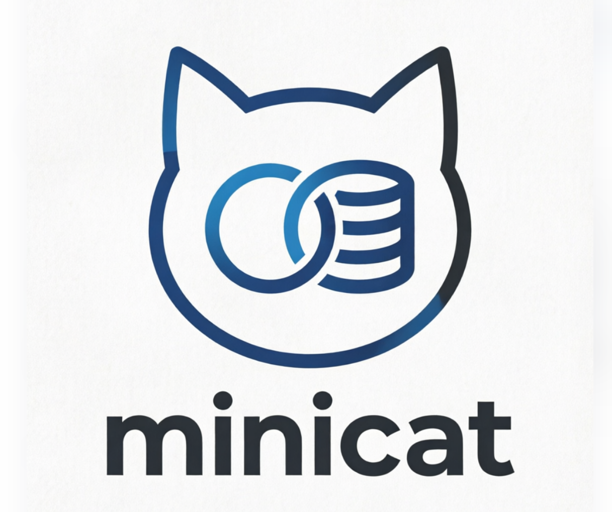

# 🐱 MiniCat - 轻量级 Web 数据库管理工具

<div align="center">



**一个现代、轻量的 Web 数据库管理工具 — 就像在浏览器中使用 Navicat。**

[](https://adoptium.net/)
[](https://spring.io/projects/spring-boot)
[](https://vuejs.org/)
[](LICENSE)

</div>

---

## 📖 项目简介

MiniCat 是一个基于 Web 的数据库管理工具，通过直观的浏览器界面管理 MySQL 和 PostgreSQL 数据库。连接多个数据库、执行 SQL 查询、浏览数据表、导入数据、监控连接池 — 无需安装桌面客户端，打开浏览器即可使用。

> [!WARNING]
> **本项目定位为「本机单用户工具」**：默认只监听 `127.0.0.1`，且没有登录认证。请勿直接部署到公网或不受信任的网络；远程访问请叠加反向代理 + HTTPS + Basic Auth / VPN。安全模型与已知限制见 [SECURITY.md](SECURITY.md)。

---

## ✨ 功能特性

### 🔌 多数据库支持
- **MySQL** 5.7+ / 8.0+（完整支持：连接、库表浏览、查询、建表、导入）
- **PostgreSQL** 12+（**实验性**：当前仅"测试连接"可用，库表浏览/建表等仍按 MySQL 方言实现，见「已知限制」）
- 同时管理多个数据库连接

### 🖥️ 现代化 Web 界面
- **Vue 3** + **Element Plus** 构建的清爽界面
- 三栏布局：侧边导航 + 内容区 + 上下文工具栏
- 实时连接状态显示（成功 / 失败 / 未测试）
- 连接测试时间的相对时间显示（刚刚 / N分钟前 / N天前）

### 🛠️ SQL 工作台
- 等宽字体 SQL 编辑器
- 基于 `sql-formatter` 的 **一键 SQL 格式化**
- 支持执行 **SELECT 查询** 和 **INSERT / UPDATE / DELETE** 语句
- 危险操作（DELETE / DROP / TRUNCATE）二次确认弹窗
- 查询结果表格展示，含执行耗时
- 数据表分页浏览（每页条数可选 20/50/100/200）

### 📊 数据表管理
- 浏览所有表及行数统计
- 查看表结构（列名、类型、是否可空、主键、默认值、注释）
- 可视化表单 **创建表**，支持多列定义
- **删除表** 确认操作
- 点击表名快速生成 `SELECT * FROM <table> LIMIT 100`

### 📥 数据导入
- 支持 **CSV**（`.csv`）和 **Excel**（`.xlsx` / `.xls`）文件导入
- 自动表头与数据库列匹配校验
- 批量插入 + 事务回滚保护
- 详细的导入结果报告（总计 / 成功 / 失败行数）

### 🔒 安全防护
- 连接密码 **AES-256-GCM 加密存储**，密钥支持环境变量或本地密钥文件
- **SQL 注入检测**：拦截常见注入特征（危险操作提醒，不是安全边界，可能误伤合法 SQL）
- 针对 SELECT / INSERT / UPDATE / DELETE / DROP TABLE 分别校验
- API 响应中 **绝不返回密码明文**
- UPDATE / DELETE 强制包含 WHERE 条件
- **默认只监听 `127.0.0.1`**，避免无意中暴露到局域网

### ⚡ 性能优化
- 每个「连接配置 + 目标数据库」独立一个 **HikariCP 连接池**，单池上限 **5**、最小空闲 1（避免多库时连接数爆炸）
- MySQL 专项优化（预编译语句缓存、批量改写、utf8mb4 字符集）
- PostgreSQL 专项优化（prepare threshold 调优）
- 连接池状态接口（`/pool-status`；前端监控面板规划中）
- 表数据服务端分页（`COUNT(*)` + `LIMIT/OFFSET`，不再由前端拼 SQL）

### 🚀 部署就绪
- **GitHub Actions** CI：后端测试（H2 内存库）/ 前端构建 / 打包三个独立 job
- **Linux/macOS**（`start.sh`）和 **Windows**（`start_win.bat`）一键启动脚本
- 生产环境配置（`application-prod.properties`）：Gzip 压缩、日志文件输出、连接池参数

---

## 🏗️ 技术栈

| 层级 | 技术 |
|------|------|
| **后端框架** | Spring Boot 3.5.14、Java 17 |
| **安全** | Spring Security |
| **元数据存储** | Spring Data JPA + H2（文件数据库） |
| **连接池** | HikariCP |
| **前端框架** | Vue 3.5（Composition API）、Vite 8 |
| **UI 组件库** | Element Plus 2.13 |
| **状态管理** | Pinia 3 |
| **路由** | Vue Router 5 |
| **HTTP 客户端** | Axios |
| **SQL 格式化** | sql-formatter |
| **Excel 解析** | Apache POI 5.2 |
| **CSV 解析** | OpenCSV 5.7 |
| **测试** | JUnit 5 + MockMvc + H2 内存库（完全隔离） |
| **构建工具** | Maven + Frontend Maven Plugin |

---

## 🚀 快速开始

### 环境要求
- **JDK 17** 或更高版本
- **Maven 3.6+**（项目已包含 Maven Wrapper，无需单独安装）

### 方式一：一键启动脚本

**Linux / macOS：**
```bash
git clone git@github.com:zhuyuebin/mini-cat.git
cd mini-cat
chmod +x start.sh
./start.sh
```

**Windows：**
```cmd
git clone git@github.com:zhuyuebin/mini-cat.git
cd mini-cat
start_win.bat
```

### 方式二：手动构建运行

```bash
git clone git@github.com:zhuyuebin/mini-cat.git
cd mini-cat

# 构建（前后端一起打包）
./mvnw clean package -DskipTests

# 运行
java -jar target/minicat-server-0.0.1-SNAPSHOT.jar
```

### 方式三：开发模式（前端热更新）

```bash
# 终端 1：启动后端
./mvnw spring-boot:run

# 终端 2：启动前端开发服务器
cd MiniCat-Frontend
npm install --registry=https://registry.npmmirror.com
npm run dev
```

前端开发服务器：**http://localhost:5173** → 自动代理 API 到后端 **http://localhost:8888**

### 访问应用

浏览器打开：**[http://localhost:8888](http://localhost:8888)**

---

## 📁 项目结构

```
mini-cat/
├── src/main/java/com/minicat/minicatserver/
│   ├── MiniCatApplication.java              # 应用入口
│   ├── config/
│   │   ├── H2ConfigConfiguration.java       # H2 元数据库配置
│   │   ├── HikariConfigProperties.java      # 连接池参数配置
│   │   └── SecurityConfig.java              # Spring Security（禁用 CSRF，开放所有请求）
│   ├── controller/
│   │   └── DatabaseController.java          # REST API 控制器（17 个接口）
│   ├── Services/
│   │   └── DatabaseService.java             # 服务层接口
│   ├── ServiceImpls/
│   │   └── DatabaseServiceImpl.java         # 核心业务逻辑
│   ├── dto/
│   │   ├── ApiResponseDTO.java              # 统一 API 响应封装
│   │   ├── ColumnInfoDTO.java               # 列元数据
│   │   ├── CreateTableDTO.java              # 建表请求
│   │   ├── ImportResult.java                # 导入结果
│   │   ├── QueryResultDTO.java              # 查询结果
│   │   ├── TableDataPageDTO.java            # 表数据分页结果
│   │   └── TableInfoDTO.java                # 表元数据
│   ├── entity/
│   │   ├── DatabaseConnection.java          # 连接 DTO（返回前端）
│   │   └── DatabaseConnectionEntity.java    # JPA 实体（存储于 H2）
│   ├── exception/
│   │   ├── ErrorCode.java                   # 业务错误码（4xxxx/5xxxx + HTTP 状态）
│   │   ├── GlobalExceptionHandler.java      # 全局异常处理器（按 ErrorCode 统一映射）
│   │   └── ...                              # 自定义异常类
│   ├── repository/
│   │   └── DatabaseConnectionRepository.java
│   └── Utils/
│       ├── ConnectionPoolManager.java       # 连接池生命周期（按 connectionId + 并发保护）
│       ├── PasswordEncryptionService.java   # AES 密码加解密
│       └── SqlInjectionValidator.java       # SQL 注入检测（4 种验证模式）
├── src/test/java/                            # 测试：纯单测 + H2 集成 + MockMvc 契约
├── MiniCat-Frontend/
│   ├── src/
│   │   ├── api/database.js                  # Axios API 客户端
│   │   ├── layout/index.vue                 # 应用外壳（侧边栏 + 头部 + 内容区）
│   │   ├── router/index.js                  # 路由：首页、连接管理、SQL工作台、数据表管理
│   │   ├── stores/connection.js             # Pinia 状态管理（当前连接）
│   │   └── views/
│   │       ├── Home.vue                     # 欢迎首页
│   │       ├── Connections.vue              # 连接增删改查 + 测试
│   │       ├── Query.vue                    # SQL 编辑器 + 结果展示 + 表树导航
│   │       └── Tables.vue                   # 数据表浏览与管理
│   ├── package.json
│   └── index.html
├── MD-Files/
│   ├── CHANGELOG.md                          # 更新日志
│   ├── CONTRIBUTING.md                       # 贡献指南
│   ├── CRUD_FEATURES.md                      # CRUD 功能说明
│   ├── SECURITY_ENHANCEMENTS.md              # 安全增强说明
│   └── USAGE.md                              # 使用指南
├── .github/workflows/build.yml               # CI：push/PR 自动构建
├── .dockerignore                              # Docker 构建上下文忽略规则
├── SECURITY.md                                # 安全模型、威胁边界与已知限制
├── pom.xml                                    # Maven 配置（含前端构建插件）
├── start.sh                                   # Linux/macOS 启动脚本
├── start_win.bat                              # Windows 启动脚本
├── restart.sh                                 # 重启脚本
└── LICENSE                                    # MIT 许可证
```

---

## 🔌 API 接口文档

基础路径：`/api/database`

### 连接管理
| 方法 | 接口 | 说明 |
|------|------|------|
| `GET` | `/connections` | 获取所有连接（密码字段已移除） |
| `GET` | `/connections/{id}` | 获取单个连接详情 |
| `POST` | `/connections` | 新增连接 |
| `PUT` | `/connections/{id}` | 更新连接 |
| `DELETE` | `/connections/{id}` | 删除连接（同时关闭连接池） |
| `POST` | `/connections/{id}/test` | 测试连接 |

### 数据库浏览
| 方法 | 接口 | 说明 |
|------|------|------|
| `GET` | `/connections/{id}/databases` | 列出所有数据库 |
| `GET` | `/connections/{id}/tables?database={db}` | 列出所有表及行数 |
| `GET` | `/connections/{id}/columns?database={db}&table={tbl}` | 获取列定义 |

### SQL 执行
| 方法 | 接口 | 说明 |
|------|------|------|
| `POST` | `/connections/{id}/query?database={db}` | 执行 SELECT 查询（Body 为原始 SQL） |
| `POST` | `/connections/{id}/update?database={db}` | 执行 INSERT/UPDATE/DELETE/DROP |

### 数据表操作
| 方法 | 接口 | 说明 |
|------|------|------|
| `POST` | `/connections/{id}/create-table?database={db}` | 创建数据表 |
| `DELETE` | `/connections/{id}/tables?database={db}&table={tbl}` | 删除数据表 |
| `GET` | `/connections/{id}/table-data?database={db}&table={tbl}&page=1&size=50` | 表数据服务端分页（返回 rows + total） |

### 数据导入
| 方法 | 接口 | 说明 |
|------|------|------|
| `POST` | `/connections/{id}/import-data?database={db}&table={tbl}` | 导入 CSV/Excel 文件 |

### 监控
| 方法 | 接口 | 说明 |
|------|------|------|
| `GET` | `/connections/{id}/info?database={db}` | 数据库产品名、版本、驱动信息 |
| `GET` | `/connections/{id}/pool-status?database={db}` | HikariCP 连接池状态 |

---

## ⚙️ 配置说明

### 应用配置

`src/main/resources/application.properties` 主要配置项：

```properties
server.port=8888                              # HTTP 端口
server.address=127.0.0.1                      # 默认只监听本机
spring.servlet.multipart.max-file-size=50MB   # CSV/Excel 导入大小上限
minicat.security.key-file=./data/secret.key   # 连接密码加密密钥文件
spring.datasource.hikari.maximum-pool-size=5  # 每个目标库连接池上限
spring.application.name=MiniCat
logging.level.com.minicat=DEBUG               # 包级别调试日志
```

容器部署时由 `docker-compose.yml` 注入 `SERVER_ADDRESS=0.0.0.0`（容器内监听所有网卡，对外暴露仍受 `ports` 限制）。

### 生产环境

```bash
java -jar minicat-server.jar --spring.profiles.active=prod
```

生产环境配置（`application-prod.properties`）：
- **Gzip** 压缩：text/html/json/css/js
- **WARN** 级别日志，输出到 `logs/minicat.log`
- **DevTools** 禁用
- **H2 控制台** 禁用
- **连接池**：单池最大 5、最小空闲 1（`spring.datasource.hikari.*`）
- **JPA**：`ddl-auto=update`，SQL 日志关闭

### 元数据与密钥

- **元数据库**：H2 文件数据库 `./data/minicat_db`，首次运行自动创建；
- **加密密钥**：`./data/secret.key`，首次运行自动生成；也可用环境变量 `MINICAT_SECRET_KEY` 提供（容器部署推荐）；
- **备份 `data/` 目录 = 保留全部连接配置与密钥**；换机器/重建容器时请一并保留，否则历史密码无法解密；
- `data/` 已在 `.gitignore` 中忽略，请勿提交。

---

## 🔐 安全机制

| 措施 | 实现方式 |
|------|----------|
| **密码加密** | `PasswordEncryptionService` 使用 AES-256-GCM，密文格式 `v2:Base64(IV+密文)`；密钥来自 `MINICAT_SECRET_KEY` 或 `./data/secret.key`（首次启动生成）。旧版本固定种子的历史密文仍可解密，并在下次保存时升级。 |
| **SQL 注入防护** | `SqlInjectionValidator` 拦截常见注入特征：UNION 注入、时间盲注、系统表访问、文件读写、命令执行等。**注意：它是正则黑名单式的危险操作提醒，不是安全边界，也可能误伤合法 SQL**。 |
| **操作约束** | UPDATE/DELETE 必须包含 WHERE 条件。`/query` 仅允许 SELECT；`/update` 仅允许 INSERT/UPDATE/DELETE/DROP。DROP TABLE 禁止多语句执行。 |
| **密码屏蔽** | GET 接口不返回密码；`POST /connections` 的响应目前会返回加密后的密文（不是明文），后续版本统一剥离。 |
| **网络暴露** | 默认 `server.address=127.0.0.1`；Docker 部署时由 compose 注入 `SERVER_ADDRESS=0.0.0.0`，端口暴露受 `ports` 控制。 |

> 完整安全模型、威胁边界与报告方式见 [SECURITY.md](SECURITY.md)。

---

## 🧪 错误码

响应体统一为 `{ code, message, data, success }`，失败时 HTTP 状态码与业务 `code` 对应如下：

| code | HTTP | 含义 |
|------|------|------|
| 200 | 200 | 成功 |
| 40001 | 400 | 参数校验失败 |
| 40301 | 403 | SQL 被安全策略拦截 |
| 40401 | 404 | 连接不存在 |
| 40901 | 409 | 数据冲突（乐观锁） |
| 50001 | 500 | SQL 执行失败 |
| 50002 | 500 | 数据库连接失败 |
| 50000 | 500 | 内部错误 |

前端 Axios 拦截器同时兼容「HTTP 200 + success=false」与「语义化 HTTP 状态码」两种失败形态，并统一弹出后端返回的 message。

---

## ⚠️ 已知限制

- 暂无登录认证、操作审计、多用户/权限体系；
- PostgreSQL 目前只有"测试连接"可用，库表浏览与建表仍按 MySQL 方言实现；
- 查询结果一次性加载到内存，没有行数上限与执行超时（大表查询需谨慎）；
- 表数据分页由服务端执行 `COUNT(*)` + `LIMIT/OFFSET`，超大表 COUNT 会较慢（规划中做估算/缓存）；
- CSV/Excel 导入要求表头与表列完全一致，暂不支持列子集映射；
- 连接"选中"状态存在前端内存中，刷新页面会丢失（规划中）；
- 连接池状态、数据库信息两个接口后端已实现，但前端尚无对应面板。

---

## 🧪 测试

```bash
# 后端全部测试（H2 内存库隔离：元数据库、密钥、测试数据都在 target/ 下，不污染 ./data）
./mvnw test

# 只跳过前端构建、快速跑测试
./mvnw -Dskip.installnodenpm -Dskip.npm test
```

| 层级 | 内容 |
|------|------|
| L1 纯单测 | `SqlInjectionValidatorTest`、`PasswordEncryptionServiceTest`、`ConnectionPoolManagerTest`、`TableDataPaginationTest` |
| L2 集成测试 | `DatabaseConnectionServiceTest`（H2 内存元数据库）：加密落库、改密码、删除、连接池回收、语义异常 |
| L3 Web 契约 | `DatabaseControllerTest`（MockMvc）：状态码 / 业务错误码 / 密码屏蔽 / 分页参数校验 |

CI 使用 GitHub Actions 三个 job：`backend-test`（真跑测试）、`frontend-build`、`package`。

---

## 🤝 参与贡献

欢迎参与贡献！详见 [CONTRIBUTING.md](MD-Files/CONTRIBUTING.md)。

1. Fork 本仓库
2. 创建功能分支：`git checkout -b feature/amazing-feature`
3. 提交代码：`git commit -m '添加了某某功能'`
4. 推送分支：`git push origin feature/amazing-feature`
5. 发起 Pull Request

---

## 📝 更新日志

详见 [CHANGELOG.md](MD-Files/CHANGELOG.md)。

**v1.1.0（M1 工程质量，待发布）** — 测试护栏（H2 内存隔离，36 个用例）+ 全量 slf4j 日志 + 语义化异常/业务错误码 + 连接池按 connectionId 生命周期管理（单池 5、并发保护）+ 表数据服务端分页接口 + CI 真跑测试。

**v1.0.1（M0 修复，待发布）** — 安全限位（默认仅监听本机、移除通配 CORS、加密密钥外置）+ 修复表结构字段/自增识别/分页三处契约 bug + 后端错误信息透传 + 导入大小限制 + 仓库清理与文档诚实化。

**v1.0.0**（2026-04-25）— 首次发布：支持 MySQL / PostgreSQL、Vue3 界面、SQL 注入防护、HikariCP 连接池、CSV/Excel 数据导入。

---

## 📄 开源协议

MIT License — 详见 [LICENSE](LICENSE)。

---

## 🙏 致谢

本项目基于以下优秀开源项目构建：

- [Spring Boot](https://spring.io/projects/spring-boot) — 后端框架
- [Vue.js](https://vuejs.org/) — 前端框架
- [Element Plus](https://element-plus.org/) — UI 组件库
- [HikariCP](https://github.com/brettwooldridge/HikariCP) — 数据库连接池
- [Apache POI](https://poi.apache.org/) — Excel 文件解析
- [OpenCSV](https://opencsv.sourceforge.net/) — CSV 文件解析

---

<div align="center">
  <b>Made with ❤️ by MiniCat Team</b>
</div>
